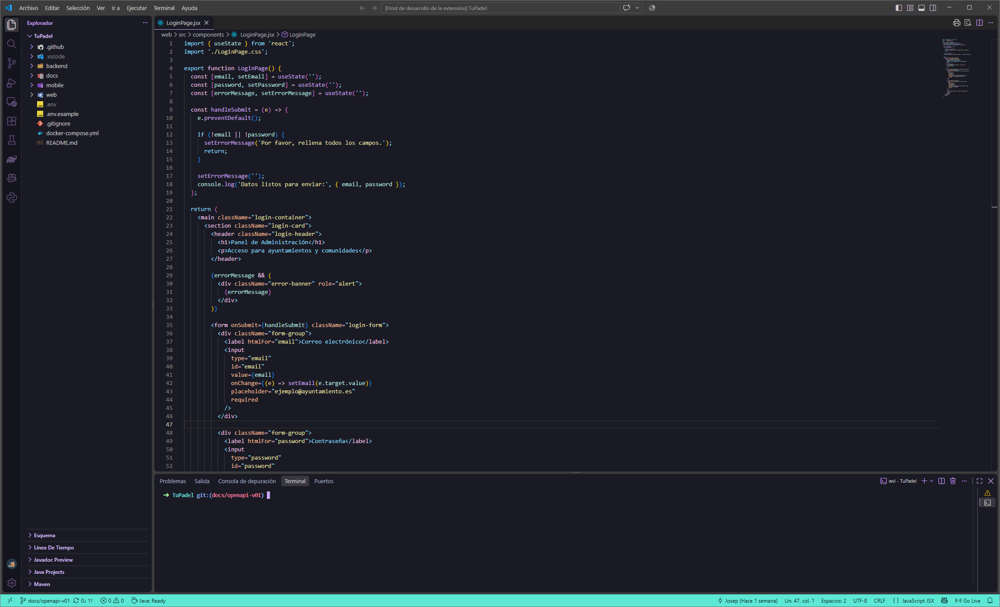
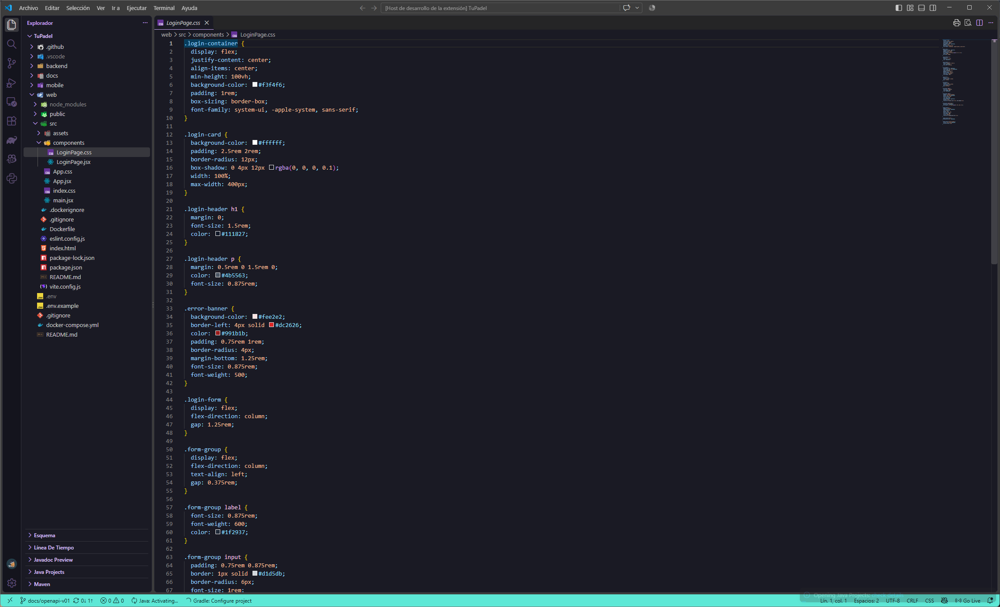

# Popi Theme

Un tema oscuro con tonos pastel diseñado para reducir la fatiga visual y mantener una estética elegante en largas sesiones de programación.

## 📸 Capturas de pantalla

## 🚀 Instalación

1. Abre Visual Studio Code.
2. Ve a la vista de Extensiones (`Ctrl+Shift+X` en Windows/Linux, `Cmd+Shift+X` en macOS).
3. Busca **Popi Theme**.
4. Haz clic en **Instalar**.
5. Presiona `Ctrl+K Ctrl+T` (`Cmd+K Cmd+T` en macOS) y selecciona el tema.

## ✨ Características

* Fondo oscuro profundo que resalta la sintaxis sin deslumbrar.
* Paleta de colores pastel cuidadosamente seleccionada (rosa, malva, cian suave).
* Alto contraste en los elementos de la interfaz (terminal, explorador de archivos).

## 🛠️ Problemas y Sugerencias

Si encuentras algún problema de contraste o quieres sugerir mejoras, por favor abre un [Issue](https://github.com/tu-usuario/tu-repo/issues) en el repositorio de GitHub.

Muchas Gracias.